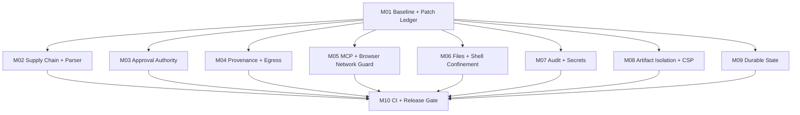

# SPEC.md

## Implementation objective

Produce `frictionless-v0.1.0+upstream.5bc10d9`, a restricted internal OpenWorker build whose enabled scope contains no reachable P0 security finding, whose dependencies are reproducible, and whose dangerous capabilities remain disabled until their dedicated evidence gates pass.

**VIZ-06 — Build the baseline first, then trust boundaries, then release automation and pilot controls.**

Alt text: A single baseline fans into eight hardening modules that must converge through one CI and release gate.

### MVP build order

| Order | Module | Blocks |
|---:|---|---|
| 1 | M01 Baseline + Patch Ledger | Everything |
| 2 | M02 Supply Chain + Spreadsheet Parser | Spreadsheet preview, release reproducibility |
| 3 | M03 Approval Authority | Connector writes, durable grants, unattended actions |
| 4 | M04 Provenance + Egress | External reads, connector sends, unattended execution |
| 5 | M05 MCP + Browser Network Guard | Remote MCP, browser automation |
| 6 | M06 Files + Shell Confinement | Shell autonomy, browser upload/download, file writes |
| 7 | M07 Audit + Secrets | High-sensitivity integrations |
| 8 | M08 Artifact Isolation + CSP | HTML/spreadsheet artifact display |
| 9 | M09 Durable State | Reliable daily use |
| 10 | M10 CI + Release Gate | Internal pilot and tag |

### Shared interfaces and event contracts

| Contract | Producer | Consumer | Required fields/behavior |
|---|---|---|---|
| `TrustOrigin` | Session ingress/tool wrapper | Provider serialization, egress gate | System-generated enum; untrusted text cannot forge it |
| `PermissionRequest` | Permission engine | UI/inbox/reviewer | Tool, arguments, risk, destination, reason, origin |
| `ApprovalOutcome` | In-app approval or validated transport | Permission engine | Deny/once/run/exact durable trust; persistent trust restricted to in-app |
| `NetworkDecision` | Shared network guard | web/MCP/browser layers | Requested URL, resolved IP, hop, allow/deny reason |
| `AuditEvent` | Tool engine | SQLite/UI | Sanitized args/result, call ID, approval provenance, resource |
| `PatchLedgerEntry` | Maintainer | CI/release docs | Finding, files, tests, upstream ref, removal condition, status |
| `ReleaseEvidence` | CI/pilot | Release gate | Check name, SHA, result, artifact/log reference |

## M01 Baseline + Patch Ledger

**Purpose**  Make every downstream change traceable to the exact upstream state and removable when upstream absorbs it.

**API contract**

| Input | Output | Error states |
|---|---|---|
| Upstream SHA `5bc10d928e0b64aae74313349a3b17bd19643ae2`, historical snapshot `01b6f83...`, finding register | Immutable archive ref, hardening branch, `docs/security/PATCH_LEDGER.md`, `docs/security/RELEASE_EVIDENCE.md` | Wrong base SHA, unclean tree, undocumented fork delta |

**Data model**  `PatchLedgerEntry(finding_id, severity, files, tests, upstream_issue_or_pr, introduced_sha, removal_condition, status)`.

**State**  Git refs are canonical; Markdown ledger mirrors downstream intent and is append-only for accepted releases.

**Acceptance booleans**

- [ ] Historical snapshot ref resolves to `01b6f83b3927e02912dda84bb392942c13ca70d1`.
- [ ] Hardening base resolves to `5bc10d928e0b64aae74313349a3b17bd19643ae2`.
- [ ] Every downstream patch row has a finding ID, tests, upstream status, and removal condition.
- [ ] `main` contains no undocumented downstream security delta.

**Edges/errors**  Upstream may advance during work; do not silently rebase after a module passes. Open a new baseline update change and rerun mandatory security gates.

## M02 Supply Chain + Spreadsheet Parser

**Purpose**  Make runtime dependency resolution reproducible and remove the known High-severity SheetJS path before spreadsheet preview can be enabled.

**API contract**

| Input | Output | Error states |
|---|---|---|
| `pyproject.toml`, npm manifest/lock, Cargo locks | Committed `uv.lock`, locked CI sync, safe spreadsheet parser dependency | Lock drift, unsupported marker, vulnerable parser remains, npm install rewrites unexpectedly |

**Data model**  Lockfiles are generated artifacts. Release evidence records package version/source and advisory scan result.

**Component tree**  `RightRail -> SheetViewer -> parser adapter`; parser adapter must be replaceable without changing artifact routing.

**State**  No mutable runtime package resolution. CI uses `uv sync --locked`; GUI uses `npm ci`.

**Acceptance booleans**

- [ ] `uv.lock` exists, is committed, and `uv lock --check` passes.
- [ ] CI/bootstrap uses `uv sync --locked` or `uv run --locked`.
- [ ] Active GUI dependency is not npm `xlsx@0.18.5`.
- [ ] Active SheetJS build is >=0.20.2 from the authoritative distribution, or a maintained replacement is used.
- [ ] GHSA-4r6h-8v6p-xvw6 and GHSA-5pgg-2g8v-p4x9 are absent from the active path.
- [ ] Hostile workbook regression fixture does not pollute prototype or hang the UI.

**Edges/errors**  Treat workbook bytes as hostile even after upgrade. Fail preview closed on parser exceptions, excessive size, timeout, or unsupported format.

## M03 Approval Authority

**Purpose**  Ensure human approval is an enforceable authority boundary, not a text-classification convention.

**API contract**

| Input | Output | Error states |
|---|---|---|
| Approval item + inbound reply/interaction + bound actor/transport | `deny`, `allow_once`, `allow_run`, or validated in-app durable grant | Mixed intent, malformed ID, wrong actor, wrong transport, external persistent-grant request |

**Data model**  `Approval(id, tool_call_id, actor_id, transport, bound_target, outcome, scope, timestamp)`; `PermissionGrant(tool, target, scope, origin=in_app)`.

**State**  Approval items are one-shot; run grants die at run boundary; durable grants persist only when minted by explicit in-app control.

**Acceptance booleans**

- [ ] `no, don't approve`, `not allowed`, and mixed intent never allow execution.
- [ ] Wrong transport, channel, actor, or item ID cannot resolve protected approvals.
- [ ] Messaging replies cannot mint `always*`, root-expanding, or scheduled persistent authority.
- [ ] Denied or ambiguous approvals stay denied/pending and emit sanitized audit evidence.

**Edges/errors**  Emoji, punctuation, legacy item tokens, reconnect/redelivery, stale approval IDs, and duplicate replies must remain safe and idempotent.

## M04 Provenance + Egress

**Purpose**  Convert prompt-injection defense from prompt-only guidance into a structural authorization signal consumed by egress decisions.

**API contract**

| Input | Output | Error states |
|---|---|---|
| Ingress message/tool result + origin metadata + proposed outbound tool call | Provider-safe content with `TrustOrigin`; egress decision `allow`, `ask`, or `deny` | Missing origin, spoofed framing, mixed-trust payload, secret-looking data, new unbound destination |

**Data model**  `TrustOrigin = owner_instruction | untrusted_external_data | untrusted_tool_result | trusted_system`; outbound call carries `derived_from` origin IDs.

**State**  Provenance survives message storage and provider serialization. Egress rules are deterministic and do not depend on the model remembering a prompt instruction.

**Acceptance booleans**

- [ ] External Slack/email/web content cannot serialize as owner-authored instruction authority.
- [ ] Tool results containing external content are marked untrusted structurally.
- [ ] A new destination carrying untrusted-derived or secret-like content asks/denies before network execution.
- [ ] Bound benign responses still work without unnecessary blocking.

**Edges/errors**  Quoted owner text inside external content, nested tool results, summaries of untrusted content, mixed owner+external drafts, and encoded tokens require provenance preservation.

## M05 MCP + Browser Network Guard

**Purpose**  Prevent model-controlled or server-controlled network flows from reaching loopback, private, link-local, metadata, or unsafe-scheme destinations outside explicit policy.

**API contract**

| Input | Output | Error states |
|---|---|---|
| URL + purpose + hop + resolved address | `NetworkDecision(allow, reason, normalized_url)` | Unsafe scheme, private/reserved IP, DNS mismatch, redirect to blocked target, metadata endpoint |

**Data model**  `NetworkDecision(requested_url, final_url, resolved_ip, hop, purpose, decision, reason)`.

**State**  Shared guard is pure except for bounded DNS/cache metadata. MCP OAuth and browser automation consume the same policy primitives.

**Acceptance booleans**

- [ ] MCP discovery/authorization/registration/token endpoints require acceptable schemes and public destinations.
- [ ] Browser public→private redirects are blocked before content becomes readable/interactable.
- [ ] Loopback, RFC1918, link-local, cloud metadata, and unsafe schemes fail mandatory tests.
- [ ] Legitimate public HTTPS MCP OAuth still completes.

**Edges/errors**  Redirect chains, DNS rebinding window, IPv6 private/link-local, mixed A/AAAA records, JS/meta refresh, and authorization URLs require explicit handling. If per-request browser interception cannot prevent every hop, remote/browser capability remains OFF.

## M06 Files + Shell Confinement

**Purpose**  Ensure alternate tools cannot read or write locations the canonical file tools would reject.

**API contract**

| Input | Output | Error states |
|---|---|---|
| Tool name + arguments/argv + granted roots + writable flags | Allow/ask/deny plus normalized resource path | Traversal, symlink escape, Windows separator escape, hidden path argument, delegate execution flag |

**Data model**  `WorkspaceRoot(path, readable, writable)` and `ResourceAccess(tool_call_id, normalized_path, access_kind, root_id)`.

**State**  Root resolution occurs at policy evaluation and again immediately before filesystem use where TOCTOU matters.

**Acceptance booleans**

- [ ] File, browser upload/screenshot, attachment, and shell path access cannot escape granted roots silently.
- [ ] `cat`, `grep`, `find`, interpreters, package managers, and exec wrappers never gain arbitrary authority from a bare allowlist entry.
- [ ] Symlink and Windows path cases pass platform-specific tests.
- [ ] In-root benign operations remain usable.

**Edges/errors**  `--file=`, relative traversal, symlink swap, glob patterns, subprocess delegation, quoted paths, and second granted roots must be covered.

## M07 Audit + Secrets

**Purpose**  Keep the audit trail useful without making it a secondary store of messages, tokens, environment values, or credentials.

**API contract**

| Input | Output | Error states |
|---|---|---|
| Structured tool result + secret classification; secret get/put/delete | Sanitized audit event; platform-protected secret value | Unknown result schema, migration failure, keychain unavailable, legacy file cleanup failure |

**Data model**  `AuditEvent` stores redacted structured previews and approval provenance. `SecretStore` remains the interface; concrete backends are platform-specific.

**State**  Migrate existing secrets transactionally. Keep a documented low-sensitivity pilot exception only if native backend cannot be completed before pilot; do not enable high-sensitivity connectors under that exception.

**Acceptance booleans**

- [ ] Email bodies, environment secret values, access tokens, API keys, and HTML content do not persist in audit previews.
- [ ] Audit rows still identify tool, stage, resource, approval origin, and call ID.
- [ ] macOS secret backend uses Keychain-equivalent native storage for launch platform.
- [ ] Migration rollback does not destroy the only credential copy.

**Edges/errors**  Secrets nested in arrays/strings, binary results, partial migration, keychain lock, and legacy data require deterministic behavior.

## M08 Artifact Isolation + CSP

**Purpose**  Prevent hostile files from turning a preview click into privileged webview code execution or uncontrolled network egress.

**API contract**

| Input | Output | Error states |
|---|---|---|
| Artifact bytes/type + preview policy | Sanitized/isolated preview or safe refusal | Active content requires forbidden privilege, external subresource, parser failure |

**Data model**  `ArtifactPolicy(kind, scripts_allowed, network_allowed, same_origin_allowed=false, max_size)`.

**Component tree**  `RightRail -> ArtifactViewer -> HtmlViewer | SheetViewer | Text/PDF viewers`; active viewers must not inherit parent authority.

**State**  Artifact policy is deterministic by type. CSP is compile-time configuration plus regression assertions.

**Acceptance booleans**

- [ ] HTML preview cannot access `parent.document` or the OpenWorker API token.
- [ ] HTML preview cannot exfiltrate through unrestricted subresources.
- [ ] Tauri CSP is non-null and as restrictive as functional requirements allow.
- [ ] Spreadsheet preview remains OFF until M02 passes.

**Edges/errors**  `srcDoc`, data URLs, inline scripts/styles, nested iframes, external images, oversized files, and parser imports require explicit policy.

## M09 Durable State

**Purpose**  Prevent a partial local write from bricking startup or silently losing critical operator state.

**API contract**

| Input | Output | Error states |
|---|---|---|
| JSON state object + destination | Atomic replacement; guarded load; quarantined corrupt file; recovery event | Disk full, interruption, invalid JSON, permission error |

**Data model**  Shared `read_json_safe`/`write_json_atomic` primitives plus `RecoveryEvent(store, reason, quarantine_ref, timestamp)`.

**State**  Write temp file, flush as appropriate, atomic replace, then load verified state. Corrupt prior state is quarantined, not overwritten blindly.

**Acceptance booleans**

- [ ] Critical JSON stores use shared atomic write helper.
- [ ] Truncated/corrupt state cannot prevent server startup.
- [ ] Recovery preserves the bad file for inspection without exposing sensitive content in logs.
- [ ] Kill/interruption tests pass repeatedly.

**Edges/errors**  Concurrent writers, Windows rename semantics, disk-full, permission errors, schema drift, and empty files require tests.

## M10 CI + Release Gate

**Purpose**  Make security and reproducibility properties merge/release requirements rather than manual memory.

**API contract**

| Input | Output | Error states |
|---|---|---|
| Source SHA + locks + tests + scanner outputs + capability config | PASS/FAIL release decision + evidence bundle + SBOM + internal build | Scanner failure, lock drift, P0 open, flaky mandatory test, capability enabled without proof |

**Data model**  `ReleaseEvidence(check, sha, status, log_ref)` and `CapabilityGate(name, default, prerequisite_checks, enabled_by, enabled_at)`.

**State**  `main` is last accepted baseline. Hardening branches are disposable. Accepted release evidence is append-only.

**Acceptance booleans**

- [ ] Backend, GUI unit/E2E, and Rust checks pass 100%.
- [ ] CodeQL covers Python, JavaScript/TypeScript, and Rust where supported by the repository build.
- [ ] Dependency review blocks newly introduced vulnerable dependencies in PRs.
- [ ] SCA reports 0 reachable High/Critical release blockers.
- [ ] SBOM generated every release.
- [ ] Remote MCP, connector writes, scheduler/unattended, HTML active preview, and spreadsheet preview default OFF until prerequisite gates pass.
- [ ] Rollback drill completes in <=15 minutes [ESTIMATED target].
- [ ] Restricted pilot completes >=7 days and >=50 tasks with 0 critical incidents and >=95% trusted task completion [ESTIMATED target].

**Edges/errors**  Security-service outage cannot silently pass. A required scanner can be retried, but release remains blocked until evidence is available or Mikkoh explicitly records a time-bounded exception that does not cover a reachable P0.
