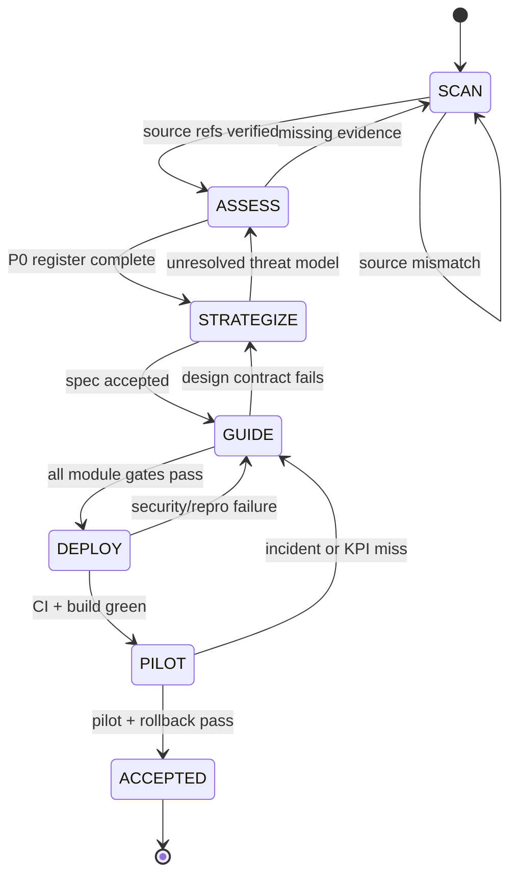

# RUNBOOK.md

## Operating rule

Advance only when the current phase gate passes. Any reachable P0, fail-open authorization case, unauthorized egress/path escape, lock drift, or missing mandatory evidence sends the implementation back to the phase that owns the failed control.

**VIZ-07 — Every phase has an explicit fail path; deployment cannot bypass failed hardening evidence.**



Alt text: ASGD progresses only through passed gates, with failures returning to the owning evidence or implementation phase.

### Session operations

| Situation | Action |
|---|---|
| Starting a module | Start a fresh Claude Code session; reference `SPEC.md`, `CLAUDE.md`, and the exact module ID |
| Context becomes noisy after one module | Use `/clear`; reopen only the module files and current test failure |
| Context is useful but long during one module | Use `/compact` after writing current decisions and test state to the module's implementation note |
| Moving from implementation to another trust-boundary module | Start fresh; do not carry speculative reasoning across modules |
| Handoff between sessions | Write the current plan, changed files, failing/passing tests, and next atomic step to `docs/security/IMPLEMENTATION_STATUS.md`; new session reads it first |
| Release/pilot session | Start fresh from committed source; do not use an implementation session with uncommitted context as release evidence |

## SCAN

**Objective**  Prove exact source identity and create immutable downstream traceability before code changes.

**Validation gate**

````bash
git status --short
git rev-parse archive/snapshot-2026-08-01
git rev-parse hardening/openworker-security-baseline-2026-09-03
````

Pass when refs match the locked SHAs, the tree is clean, and patch ledger coverage is 100%.

**Rollback**  `git switch main`; preserve the failed branch for evidence. Do not rewrite the archive ref.

## ASSESS

**Objective**  Reconfirm the active P0/P1 register against the exact baseline and turn every blocker into a testable disposition.

Re-audit the exact current baseline for OW-SEC-001 through OW-SEC-017 and OW-REL-001. For each finding, mark one of `inherited-upstream-fix`, `downstream-fix-required`, `disabled-by-capability-gate`, or `not-reproducible-with-evidence`. Update `docs/security/PATCH_LEDGER.md` only. Do not implement fixes.

**Validation gate**  100% P0 rows have owner, fix/disable plan, regression test, and release prerequisite.

**Rollback**  Revert assessment-document changes only through a normal Git revert commit if already committed; never delete evidence history.

## STRATEGIZE

**Objective**  Freeze implementation contracts so each security module can be executed independently without cross-module drift.

**Validation gate**  VIZ-06 dependency order is acyclic; every P0 maps to one primary module and M10 release evidence.

**Rollback**  Reopen ASSESS if threat-model facts changed; otherwise fix the spec before code work.

## GUIDE

**Objective**  Implement M01 through M09 in order, one focused branch/session at a time, preserving regression evidence with each patch.

**Validation gate by module**

| Module | Required pass bar |
|---|---|
| M01 | Exact refs + complete patch ledger |
| M02 | `uv lock --check`; locked sync; SheetJS advisories absent; hostile workbook tests pass |
| M03 | 0 fail-open approval corpus cases |
| M04 | 0 mandatory authority-escalation/new-destination egress cases |
| M05 | 0 mandatory private/link-local/unsafe-scheme network cases |
| M06 | 0 path escapes and 0 dangerous bare-command auto-runs |
| M07 | 0 secret/body audit samples; native launch-platform secret round-trip passes |
| M08 | Parent/token access impossible; CSP non-null; artifact network policy tested |
| M09 | Corrupt/truncated state cannot brick startup; atomic persistence tests pass |

**Core validation commands**

````bash
uv run --locked pytest tests -q
(cd surfaces/gui && npm test)
(cd surfaces/gui && npm run build)
(cd surfaces/gui && npm run e2e)
cargo test --manifest-path stt/Cargo.toml
cargo check --manifest-path surfaces/gui/src-tauri/Cargo.toml
````

**Rollback**  Before risky edits, commit the last green module state. On module failure, `git stash push -u -m "failed-module-work"`, switch to the last green commit/branch, preserve failing fixtures, and reopen the module in a fresh session.

## DEPLOY

**Objective**  Convert module evidence into required CI, build the restricted artifact, prove rollback, and run the measured pilot.

**Validation gate**

| Evidence | Pass bar |
|---|---|
| Backend | 100% pytest pass |
| GUI | 100% unit + E2E pass |
| Rust | `cargo test` STT and Tauri `cargo check` pass |
| Static/security | 0 reachable release-blocking High/Critical findings |
| Supply chain | Locks valid; dependency review/SCA green; SBOM generated |
| Authority | Approval/provenance/egress corpus 100% pass |
| Boundaries | MCP/browser/path/artifact/audit/persistence corpora 100% pass |
| Rollback | Known-good release restored in <=15 minutes [ESTIMATED] |
| Pilot | >=7 days and >=50 tasks, 0 critical incidents, >=95% trusted completion [ESTIMATED] |

**Internal build command**

````bash
bash packaging/build_dmg.sh
````

**Rollback**

1. Disable risky capabilities first.
2. Preserve the failing audit/release evidence.
3. `git switch main` for the last accepted source baseline.
4. Rebuild from the last accepted tag if a packaged rollback is required.
5. Open/update a finding and regression test before attempting re-enable.

## Handoff protocol

Before `/clear` or starting a new session, update `docs/security/IMPLEMENTATION_STATUS.md` with exactly these fields.

| Field | Required content |
|---|---|
| Baseline | Current commit SHA and module branch |
| Module | Current M01-M10 ID and acceptance booleans |
| Changed files | Exact repository-relative paths |
| Tests | Commands and PASS/FAIL summary |
| Findings | Finding IDs changed or newly discovered |
| Decisions | Any explicit Mikkoh risk/capability decision |
| Next step | One atomic next action, not a backlog |

New session instruction is always: read `CLAUDE.md`, `SPEC.md`, `docs/RUNBOOK.md`, `docs/security/IMPLEMENTATION_STATUS.md`, and only the source/tests relevant to the active module.

## Tests per phase

| Phase | Test/evidence | Pass bar |
|---|---|---|
| SCAN | Git ref and delta validation | Exact locked SHAs, clean tree, 100% patch-ledger coverage |
| ASSESS | Finding-source reproduction or code-path inspection | Every reachable P0 has a fix/test/disable disposition |
| STRATEGIZE | Traceability and dependency review | Every P0 maps to one module; build graph has no blocking cycle |
| GUIDE | Narrow regression + full affected suite + core full suite | Every module boolean true; 0 mandatory security-case failures |
| DEPLOY | Required CI, SCA/CodeQL/dependency review, SBOM, build, rollback, pilot | 100% mandatory checks; 0 reachable P0; pilot and rollback targets met |

## Done

The project is done only when the S6 north star and release thresholds are met: no reachable P0 in enabled scope, all mandatory tests green, locked reproducibility, sanitized audit/native secrets for enabled high-sensitivity use, successful rollback drill, and pilot Trusted Task Completion Rate >=95% with 0 critical incidents. [A][ESTIMATED]
